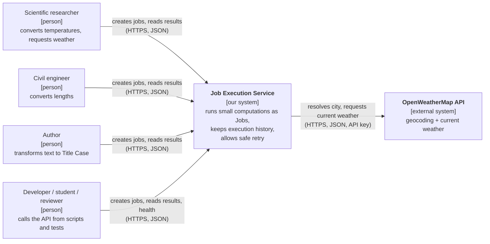

# Architecture of Job Execution Service

## 1. Context diagram (C4 level: Context)

**What the arrows show:** runtime **calls** (who sends a request to whom). The arrow points from the caller to the
callee; the label says what is requested and over which protocol. The database is not shown: at this level it is
part of our system (it appears on the component diagram).

**Intentionally not shown:** internal structure, the database, deployment.

## 2. Component diagram (C4 level: Component)