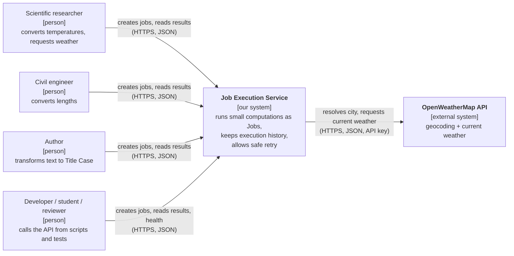
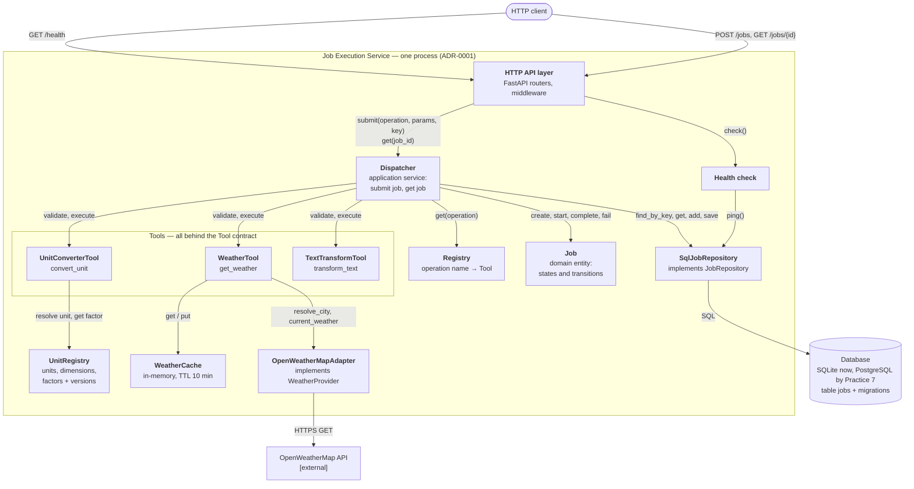

# Architecture of Job Execution Service

## 1. Context diagram (C4 level: Context)

**What the arrows show:** runtime **calls** (who sends a request to whom). The arrow points from the caller to the
callee; the label says what is requested and over which protocol. The database is not shown: at this level it is
part of our system (it appears on the component diagram).

**Intentionally not shown:** internal structure, the database, deployment.

## 2. Component diagram (C4 level: Component)

**What the arrows show:** runtime **calls** inside one process (except the two edges leaving the process:
SQL to the database and HTTPS to OpenWeatherMap). The arrow points from caller to callee, and the label names the
method or request. The composition root (`main.py`) is not drawn: it only **creates** the objects at startup
(reads configuration from environment variables, builds the Registry, injects the repository and the adapter) and
takes no part in handling a request.

### Components: responsibility and what each one hides from its neighbours

| Component | Responsible for | Hides from neighbours |
|---|---|---|
| **HTTP API layer** | HTTP contract from `openapi.yaml`: routing, body size limit (64 KiB), JSON parsing, `Idempotency-Key` and `X-Correlation-Id` headers, mapping application errors to HTTP status codes and the unified error body. | HTTP protocol details: status codes, headers, JSON shapes. Nothing below it knows that HTTP exists (a CLI could call the Dispatcher the same way). |
| **Dispatcher** | The scenario "run a Job": idempotency lookup, Tool lookup in the Registry, calling `Tool.validate`, creating and saving the Job, `Tool.execute`, recording the result or error. Also startup recovery of interrupted Jobs. | The order of steps and the idempotency rule. Callers only see `submit()` and `get()`. |
| **Registry** | Mapping `operation` name → Tool instance; rejects duplicate names at startup; lists available operations for the `UNKNOWN_OPERATION` error. | Which Tools exist and how they were constructed. The Dispatcher never names a concrete Tool. |
| **Job** (domain) | Job states, allowed transitions, invariants (section 3). Raises `InvalidJobTransition` on a forbidden transition. | Transition rules. Nobody sets `status` directly. |
| **UnitConverterTool** | `convert_unit`: unit aliases (`F`, `°F`, `fahrenheit` -> `F`), dimension check, canonical temperature formulas, factor-based length conversion, half-up rounding, uncertainty propagation. | The conversion algorithm and the unit registry. |
| **UnitRegistry** | Units named in `requirements.md` (scenarios 1, 3, 6), their dimensions, exact factors with id and version. | How factors are stored and versioned. |
| **WeatherTool** | `get_weather`: cache lookup (key: resolved location + units), call to `WeatherProvider`, range validation of the provider data, imperial pressure in inHg, attribution. | Caching policy and range rules. |
| **WeatherCache** | Fresh entries (≤ 10 min) per location + units; only successful, validated responses are stored. | Storage of cache entries (in-memory in v1; lost on restart — acceptable). |
| **OpenWeatherMapAdapter** | Translating our request into OpenWeatherMap calls and their responses/errors into our `WeatherData` / `WeatherError`; connect timeout 3 s, read timeout 10 s, bounded retry (see `tool-contract.md`). | URLs, API key, OpenWeatherMap JSON field names, HTTP status codes of the provider. A renamed provider field changes only this component. |
| **SqlJobRepository** | Storing and loading Jobs; unique constraint on the idempotency key; migrations. | SQL, table layout, the DBMS (SQLite -> PostgreSQL). |
| **Health check** | `GET /health`: process is up and the database answers. | How the database is checked. |

## 3. Job state diagram